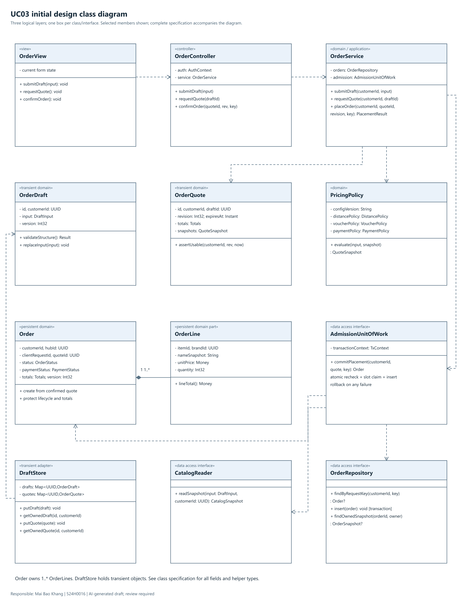
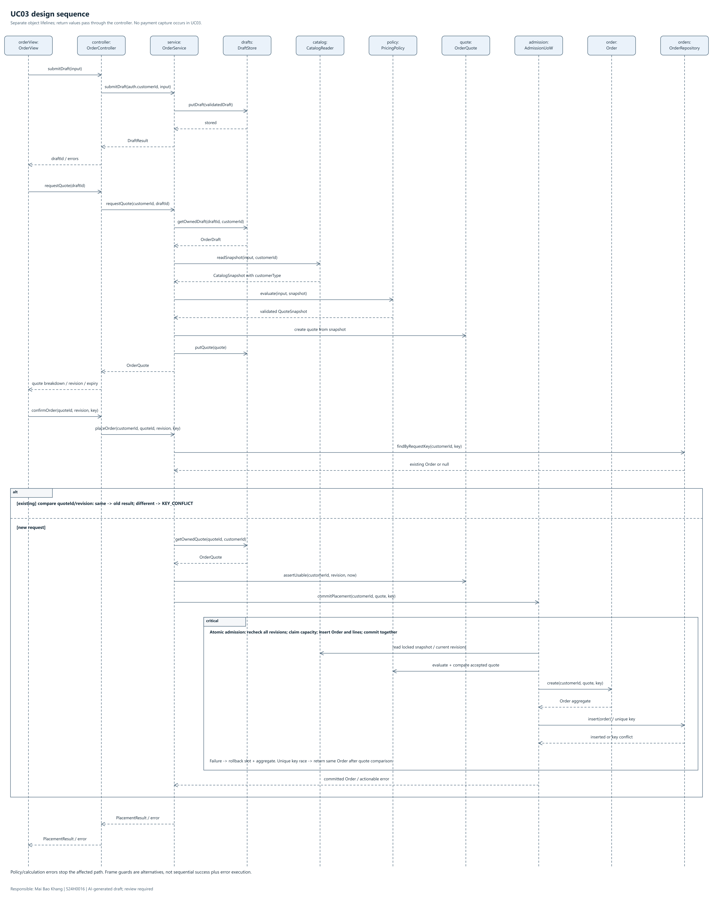
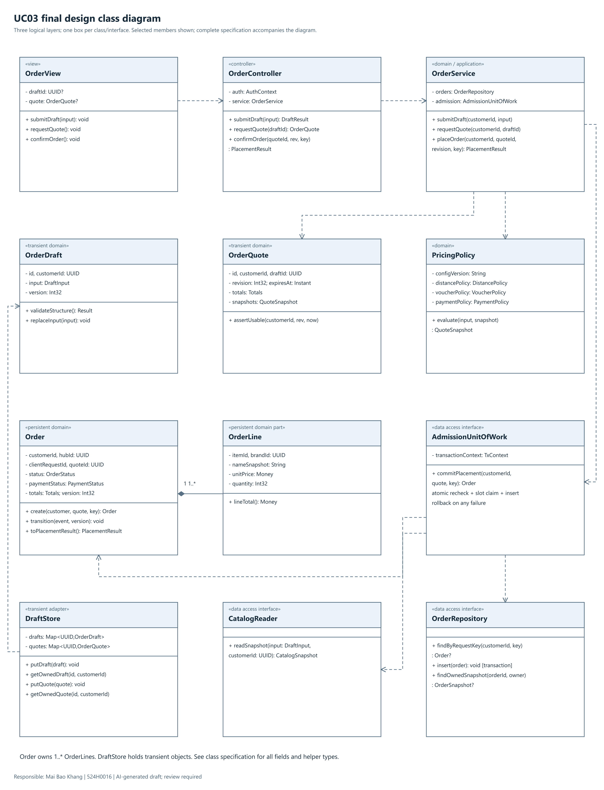
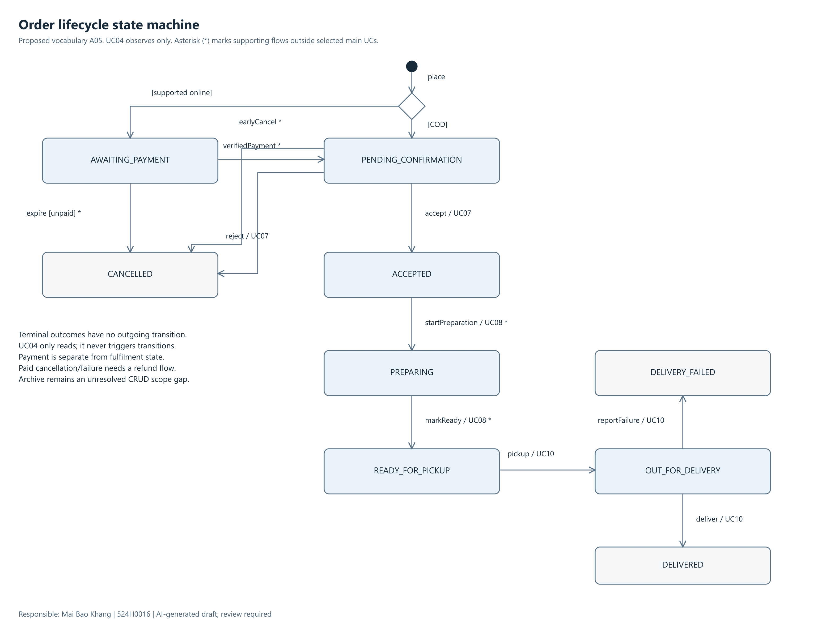

# III Customer Subsystem Design

**Responsible student:** Mai Bảo Khang — 524H0016. **AI-generated draft.** Các lớp dưới đây là specification; không phải source code đã thực thi. Tên operation cố ý khớp với SSD và design sequence.

## Architecture and types

Ba lớp logic: presentation; business/application (controller + domain/services); data access/integration. Sơ đồ gắn stereotype `view`, `controller`, `domain`, `data access` để hiển thị bốn vai trò đề yêu cầu. Controller lấy identity từ AuthContext và điều phối; domain chịu business rules; repository thực hiện truy vấn/transaction. View không gọi thẳng database; domain không phụ thuộc view.

Types: UUID = identifier; Instant = UTC timestamp; Money = Int64 VND theo A12; Decimal = distance; Int32 = quantity/version; `?` = optional; `List<T>` = collection. Visibility `+` public, `−` private. DTO và snapshots không mặc định là persistent domain classes. Order, OrderLine và capacity hub là dữ liệu lưu lâu dài cần Tài kiểm CRUD.

## UC03 Design classes

### Class attributes and responsibilities

| Class / role | Attributes with visibility and type | Responsibility |
|---|---|---|
| OrderView / view | −draftId: UUID?; −quote: OrderQuote?; −clientRequestId: UUID?; −errors: List<FieldError> | Thu input, hiển thị breakdown, chỉ confirm sau khi khách xem quote; reuse request key khi retry |
| OrderController / controller | −auth: AuthContext; −service: OrderService | Lấy customerId trusted, validate envelope; trả DTO/errors |
| OrderService / application-domain | −drafts: DraftStore; −catalog: CatalogReader; −policy: PricingPolicy; −orders: OrderRepository; −admission: AdmissionUnitOfWork | Quote, revalidation, idempotency và atomic placement |
| OrderDraft / transient domain | −id: UUID; −customerId: UUID; −input: DraftInput; −version: Int32 | Bảo đảm một hub, lines hợp lệ và một voucher; thay input vô hiệu quote |
| OrderQuote / transient domain | −id: UUID; −customerId: UUID; −draftId: UUID; −revision: Int32; −expiresAt: Instant; −totals: Totals; −snapshots: QuoteSnapshot | Quote có quyền sở hữu, hiệu lực và dữ liệu để so với confirm |
| PricingPolicy / domain | −configVersion: String; −distancePolicy: DistancePolicy; −voucherPolicy: VoucherPolicy; −paymentPolicy: PaymentPolicy | Tính breakdown bằng cấu hình, validate method, voucher và distance |
| Order / persistent domain | −id: UUID; −customerId: UUID; −hubId: UUID; −clientRequestId: UUID; −quoteId: UUID; −quoteRevision: Int32; −status: OrderStatus; −paymentStatus: PaymentStatus; −paymentMethod: PaymentMethod; −address: DeliveryAddress; −totals: Totals; −lines: List<OrderLine>; −version: Int32; −placedAt: Instant; −updatedAt: Instant; −milestones: List<Milestone> | Aggregate giữ snapshot và lifecycle; không có setter public cho state |
| OrderLine / persistent part | −id: UUID; −itemId: UUID; −brandId: UUID; −nameSnapshot: String; −unitPrice: Money; −quantity: Int32 | Thành phần của đúng một Order; tính line total |
| DraftStore / transient adapter | −drafts: Map<UUID,OrderDraft>; −quotes: Map<UUID,OrderQuote> | Lưu draft/quote server-side có TTL, chưa lưu DB trong thiết kế này |
| CatalogReader / data access interface | Không lộ connection hoặc PII | Đọc hub/item/reference snapshots và revisions |
| OrderRepository / data access interface | Không có thuộc tính public | Tìm đơn theo request key, ghi aggregate và truy vấn snapshot chính chủ |
| AdmissionUnitOfWork / data access interface | −transactionContext: TransactionContext | Khóa/check lại capacity/availability/policy revision; reserve và insert atomically |

### Public operations and contracts

| Class | Signature | Contract |
|---|---|---|
| OrderView | +submitDraft(input: DraftInput): void; +requestQuote(): void; +confirmOrder(): void | Event UI gọi controller; không tự tính giá đáng tin cậy |
| OrderController | +submitDraft(input: DraftInput): DraftResult | Gọi service.submitDraft(auth.customerId, input) |
| OrderController | +requestQuote(draftId: UUID): OrderQuote | Gọi service.requestQuote(auth.customerId, draftId) |
| OrderController | +confirmOrder(quoteId: UUID, revision: Int32, key: UUID): PlacementResult | Gọi service.placeOrder với identity trusted |
| OrderService | +submitDraft(customerId: UUID, input: DraftInput): DraftResult | Validate cấu trúc, tạo/cập nhật transient draft |
| OrderService | +requestQuote(customerId: UUID, draftId: UUID): OrderQuote | Validate ownership, load catalog, policy.evaluate, lưu quote |
| OrderService | +placeOrder(customerId: UUID, quoteId: UUID, revision: Int32, key: UUID): PlacementResult | Lookup idempotent trước; đọc quote chính chủ; revalidation/commit trong AdmissionUnitOfWork |
| OrderDraft | +validateStructure(): ValidationResult; +replaceInput(input: DraftInput): void | Quantity >0; một hub; voucher tối đa một; version tăng khi đổi |
| OrderQuote | +create(customerId: UUID, draftId: UUID, snapshot: QuoteSnapshot): OrderQuote [factory]; +assertUsable(customerId: UUID, revision: Int32, now: Instant): void | Factory tạo quote bất biến với revision/expiry; sai chủ, hết hạn hoặc revision sai thì từ chối |
| PricingPolicy | +evaluate(input: DraftInput, snapshot: CatalogSnapshot): QuoteSnapshot | Tính distance/fees/incentive/voucher và kiểm payment method; trả policy revision |
| Order | +create(customerId: UUID, quote: OrderQuote, key: UUID): Order [factory]; +transition(event: OrderEvent, expectedVersion: Int32): void; +toPlacementResult(): PlacementResult | Factory tạo COD pending hoặc online awaiting; transition theo State Contract và version |
| OrderLine | +lineTotal(): Money | unitPrice × quantity, kiểm overflow khi implement |
| DraftStore | +putDraft(draft: OrderDraft): void; +getOwnedDraft(id: UUID, customerId: UUID): OrderDraft; +putQuote(quote: OrderQuote): void; +getOwnedQuote(id: UUID, customerId: UUID): OrderQuote | TTL cấu hình; không cho quote khách khác |
| CatalogReader | +readSnapshot(input: DraftInput, customerId: UUID): CatalogSnapshot | Hub, item availability, price, capacity view, revisions và customerType từ identity được kiểm chứng; không lấy loại khách từ form |
| OrderRepository | +findByRequestKey(customerId: UUID, key: UUID): Order?; +insert(order: Order): void; +findOwnedSnapshot(orderId: UUID, customerId: UUID): OrderSnapshot? | insert chỉ trong transaction; unique key; tracking query read-only |
| AdmissionUnitOfWork | +commitPlacement(customerId: UUID, quote: OrderQuote, key: UUID): Order | Atomic revalidate + claim slot + factory + insert; conflict key → đọc lại, so quoteId/revision; không gọi payment gateway |

Các dependencies DistancePolicy/VoucherPolicy/PaymentPolicy và AuthContext là interface hỗ trợ. `commitPlacement` phải kiểm tra revision/giá/khả dụng dưới ranh giới transaction hoặc concurrency control tương đương; chỉ kiểm ở service rồi insert riêng sẽ không đáp ứng FR07. DraftStore có thể mất khi restart; đây là trade-off được công bố, Order đã commit vẫn tra cứu bằng key. Persistence bổ sung cho draft/quote nếu có phải cập nhật domain/CRUD.

### Initial Design Class Diagram

### CRC cards for UC03

| Class | Responsibilities | Collaborators |
|---|---|---|
| OrderView | Thu input, hiển thị quote/errors/result, giữ request key | OrderController |
| OrderController | Lấy identity, điều phối operation SSD, map lỗi | AuthContext, OrderService |
| OrderService | Quản lý draft/quote, tìm kết quả retry, yêu cầu atomic admission | DraftStore, CatalogReader, PricingPolicy, OrderRepository, AdmissionUnitOfWork |
| PricingPolicy | Kiểm distance/voucher/method và tính totals | DistancePolicy, VoucherPolicy, PaymentPolicy |
| Order | Giữ bất biến và khởi tạo trạng thái; snapshot dữ liệu | OrderLine, OrderQuote |
| AdmissionUnitOfWork | Revalidation dưới lock/transaction, claim slot, lưu/rollback | CatalogReader, PricingPolicy, Order, OrderRepository |

### Design Sequence Diagram

Sequence triển khai các operation SSD thành lời gọi giữa đối tượng, có nhánh retry, quote thay đổi và rollback. Đây là mô hình thiết kế có data-access responsibility, chưa phải modified implementation sequence của Section IV với SQL/ORM thực.

### Final Design Class Diagram

So với initial DCD, bản final bổ sung operation/kiểu dữ liệu, ownership của draft/quote, quote revision, request key, transaction admission và multiplicity Order–OrderLine. Danh sách đặc tả phía trên là nguồn đầy đủ cho thuộc tính/phương thức, sơ đồ chỉ hiển thị phần cần đọc nhanh.

## State Machine for Order

Ít nhất một State Machine cho Khang; đối tượng được chọn là Order. Bản này phục vụ cả UC03 và UC04, cần Thành/Tài xác nhận. State machine là lifecycle tham chiếu, không tuyên bố mọi transition đã có main UC owner.

| From | Event [guard] | To | Owner / side effect |
|---|---|---|---|
| Initial | place [COD] | PENDING_CONFIRMATION | UC03; payment UNPAID; claim slot |
| Initial | place [supported online] | AWAITING_PAYMENT | UC03; payment UNPAID; claim slot có expiry A03 |
| AWAITING_PAYMENT | verifiedPayment [trusted, not expired] | PENDING_CONFIRMATION | Supporting payment flow G06; payment PAID |
| AWAITING_PAYMENT | expire [still unpaid] | CANCELLED | Supporting timeout A13; release slot; late payment reconciliation chưa chốt |
| PENDING_CONFIRMATION | accept [version matches] | ACCEPTED | UC07 |
| PENDING_CONFIRMATION | reject [reason recorded] | CANCELLED | UC07; release slot; nếu paid → refund dependency |
| PENDING_CONFIRMATION | earlyCancel [policy allows] | CANCELLED | UC05 ngoài portfolio; A13 |
| ACCEPTED | startPreparation | PREPARING | UC08 ngoài portfolio; A13 |
| PREPARING | markReady | READY_FOR_PICKUP | UC08 ngoài portfolio; A13 |
| READY_FOR_PICKUP | pickup [assigned shipper] | OUT_FOR_DELIVERY | UC10 |
| OUT_FOR_DELIVERY | deliver | DELIVERED | UC10; release slot theo A03; COD thu được cập nhật payment PAID |
| OUT_FOR_DELIVERY | reportFailure [reason recorded] | DELIVERY_FAILED | UC10; release slot; nếu paid → refund dependency |

DELIVERED, CANCELLED, DELIVERY_FAILED là terminal trong baseline Order lifecycle; không cho chuyển về pending. Archive là lifecycle dữ liệu riêng còn thiếu scope CRUD, không tự thêm vào state machine để che gap. REFUND_PENDING/REFUNDED là trạng thái tiền ngoài mô hình Order hiện tại, cần supporting payment/refund contract sau Q&A.

### Customer labels

| Internal state | Customer label | UC04 handling |
|---|---|---|
| AWAITING_PAYMENT | Chờ thanh toán | Chưa vào bếp; không báo paid |
| PENDING_CONFIRMATION | Chờ bếp xác nhận | Đã đặt, bếp chưa chấp nhận |
| ACCEPTED | Bếp đã nhận đơn | Không đồng nghĩa đã chuẩn bị xong |
| PREPARING | Đang chuẩn bị | Chỉ khi event hợp lệ đã commit |
| READY_FOR_PICKUP | Sẵn sàng giao cho shipper | Chưa phải đang trên đường |
| OUT_FOR_DELIVERY | Đang giao | Đã pickup |
| DELIVERED | Đã giao | Hiển thị paymentStatus độc lập |
| CANCELLED | Đã hủy | Lý do an toàn nếu có |
| DELIVERY_FAILED | Giao thất bại | Lý do an toàn nếu có |

