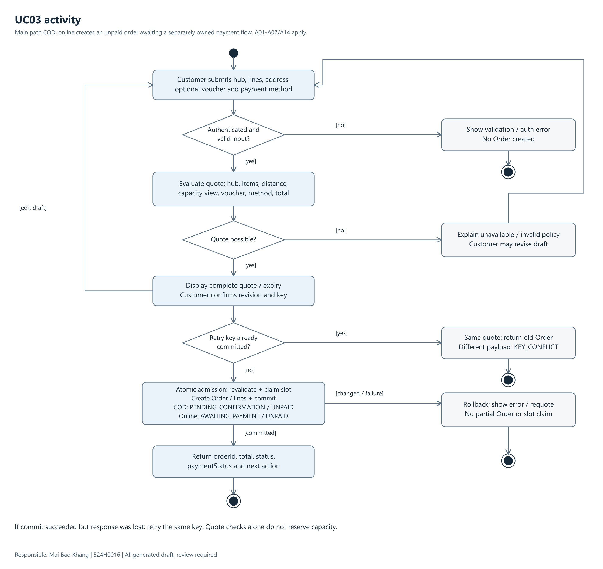
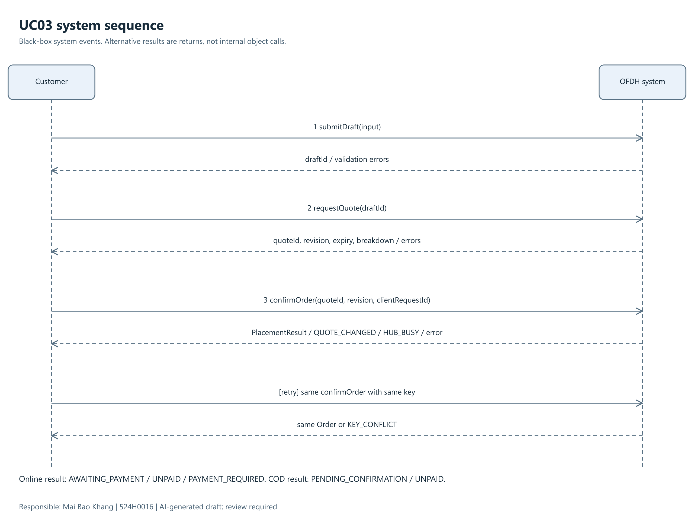

# II UC03 Place an Order

**Owner:** Mai Bảo Khang — 524H0016. **AI-generated draft.** Scope: phân tích và thiết kế Sprint 1; chưa có implementation hoặc test execution.

## Customer analysis context

System narrative: OFDH nhận input đặt món từ Customer, đánh giá policy trên dữ liệu hub/catalog và tạo Order trong một giao dịch nhất quán. Customer nhận kết quả đặt đơn rồi dùng UC04 để truy vấn tiến độ. Các sự kiện bếp/shipper cập nhật Order được cung cấp từ subsystem của Thành; khách chỉ đọc kết quả đã commit. Payment, preparation và master-data lifecycle có dependency ngoài hai UC, được ghi riêng trong handoff.

| User / actor | Goal | Use case boundary |
|---|---|---|
| Local Customer | Tạo đơn và chọn COD/online method phù hợp | UC03; không bao gồm đăng ký hoặc CRUD địa chỉ |
| Foreign Tourist | Tạo đơn với dữ liệu giao phù hợp, không bị buộc số VN | Cùng UC03; khác policy/payment reference, không cần thêm main UC |
| Customer đã có đơn | Đọc tiến độ đơn chính chủ | UC04; không hủy/sửa Order hoặc tự chuyển state |

Actors của diagram tổng thể nằm trong Integration Handoff. Đầu vào Events Table cho Thành: Customer requests placement; Customer requests quote; Customer confirms placement; Customer requests order progress. Thành cần phân biệt business event ở user-goal level với các system message chi tiết trong SSD, không mặc định mỗi lời gọi API là một main UC mới.

## Fully developed use case description

| Field | Specification |
|---|---|
| ID / name | UC03 — Place an Order |
| Level / primary actor | User goal / Customer (local or tourist) |
| Goal | Tạo một đơn hợp lệ tại một hub, biết giá cuối và chọn phương thức thanh toán |
| Stakeholders | Customer: đúng món/giá; Kitchen: không vượt capacity; Manager: dữ liệu đúng; Shipper: địa chỉ giao hợp lệ |
| Trigger | Customer chọn bắt đầu đặt món tại một hub |
| Preconditions | P03.1 customer authenticated (A01); P03.2 hub/catalog/policy đọc được; P03.3 có dữ liệu tham chiếu hợp lệ để chọn món; không giả định hub luôn còn slot |
| Success guarantee | POST03.1 đúng một Order của customer cho clientRequestId; POST03.2 lines, address snapshot, totals, method lưu atomically; POST03.3 tổng khớp quote vừa được xác nhận; POST03.4 COD → PENDING_CONFIRMATION/UNPAID, online → AWAITING_PAYMENT/UNPAID; POST03.5 admission slot giữ theo policy |
| Minimal guarantee | Trước commit không tạo đơn dở dang hoặc trừ tiền; validation failure không giữ slot. Nếu response mất sau commit, retry cùng key trả chính order cũ |
| Related requirements | FR01–FR08, NFR01–04/06–08; BR01–06; A01–A07/A12/A14 |
| Frequency | Tăng mạnh giờ trưa/tối; chưa có số liệu tải thực |

### Main success scenario with COD

1. Customer mở OrderView; hệ thống nhận customerId từ AuthContext, không tin customerId do form gửi.
2. Customer gửi hubId, itemId/quantity và địa chỉ giao qua `submitDraft(input)`; hệ thống xác thực một hub, ít nhất một line, quantity nguyên dương và địa chỉ đủ trường.
3. Customer thêm hoặc bỏ một voucher tùy chọn, chọn COD; hệ thống cập nhật draft tạm và kiểm tra phương thức theo customerType.
4. Customer yêu cầu `requestQuote(draftId)`; hệ thống kiểm tra hub, món, distance, capacity hiện tại và voucher rồi tính breakdown. Đây là kiểm tra sơ bộ, chưa giữ slot.
5. Hệ thống trả quoteId/revision/expiry, các line, address summary, distance, subtotal, deliveryFee, surcharge, discount, total/currency và thông báo incentive nếu có. Customer đọc và đồng ý.
6. Customer gửi `confirmOrder(quoteId, revision, clientRequestId)`.
7. Hệ thống kiểm tra lại quyền sở hữu quote, hiệu lực và revision; kiểm tra lại policy, giá, availability và capacity. Nếu có thay đổi, chuyển E03.3, không tự dùng giá mới.
8. Trong một transaction, hệ thống claim capacity, tạo Order/OrderLine với snapshot giá/địa chỉ, trạng thái PENDING_CONFIRMATION và payment UNPAID. Unique key (customerId, clientRequestId) chống tạo trùng. Commit thành công mới có kết quả đặt đơn.
9. Hệ thống trả PlacementResult chứa orderId, status, paymentStatus, totals và placedAt; OrderView hiển thị xác nhận và liên kết Track Order. Kitchen UC07 có thể truy vấn Order này.

### Alternatives and exceptions

| ID / location | Condition | System response and continuation |
|---|---|---|
| A03.1 / step 3 | Không dùng voucher | Quote discount theo policy không-voucher/quiet incentive đã chốt; tiếp step 4 |
| A03.2 / step 3–9 | Chọn online được policy cho phép | Vẫn tính và confirm như COD nhưng tạo AWAITING_PAYMENT/UNPAID; trả nextAction PAYMENT_REQUIRED. Thanh toán thực không nằm trong UC03; chỉ kết quả server-verified từ supporting payment flow mới đổi sang PENDING_CONFIRMATION/PAID (G06) |
| A03.3 / step 2–5 | Customer sửa món/địa chỉ/voucher/method | Vô hiệu quote cũ, cập nhật draft và lấy quote mới; không tái sử dụng total cũ |
| A03.4 / step 6–9 | Retry cùng clientRequestId sau response bị mất | Tìm đơn theo customer/key; cùng quote và revision trả order cũ; payload khác trả KEY_CONFLICT; không claim thêm slot |
| E03.1 / step 2 | Guest, sai quyền, input thiếu/quantity sai/món khác hub | Trả lỗi an toàn; không tạo đơn; cho sửa input hoặc đăng nhập lại |
| E03.2 / step 4 | Ngoài bán kính, hub bận, món unavailable hoặc voucher sai | Trả mã/lý do; gợi ý hub khác khi có; chỉ re-quote sau khi customer thay đổi; không tự chuyển hub |
| E03.3 / step 7 | Quote hết hạn hoặc dữ liệu/giá/capacity thay đổi | Trả QUOTE_CHANGED/EXPIRED hoặc HUB_BUSY; yêu cầu customer xem quote mới và xác nhận lại |
| E03.4 / step 3–7 | Online method không phù hợp loại khách hoặc chưa cấu hình | Trả METHOD_UNSUPPORTED; cho chọn phương thức được hỗ trợ; COD vẫn là lựa chọn cho cả hai loại |
| E03.5 / step 8 | Database/transaction lỗi | Rollback order, lines và capacity claim; trả TEMPORARY_FAILURE với request key; không gọi gateway trừ tiền |
| E03.6 / step 9 | Commit xong nhưng phản hồi mất | Không rollback đơn đã commit; client retry cùng key để lấy kết quả, hoặc tìm đơn của mình trong tracking |
| E03.7 / any before commit | Customer rời màn hình | Không tạo Order; draft/quote transient hết hạn; không claim slot |

### Data and calculation contract

- `DraftInput`: hubId: UUID; lines: List<ItemQuantity>; address: DeliveryAddress; voucherCode: String?; paymentMethod: PaymentMethod. Customer identity lấy từ server session.
- `DeliveryAddress`: recipientName, contactChannel, addressText, coordinates hoặc distance-input được DistancePolicy hỗ trợ. Không bắt khách du lịch phải có số VN; kênh liên hệ phải xác nhận theo A01/A02.
- `OrderQuote`: quoteId, customerId, draftId, revision, expiresAt, validatedSnapshots, distanceKm, totals. Quote là transient server-side object; không mô hình quote thành persistent entity trong Sprint 1.
- `Money`: Int64 đồng VND (A12). `subtotal = Σ(unitPriceSnapshot × quantity)`; `total = subtotal + deliveryFee + surcharge − discount`. Kiểm tra discount ≥ 0 và không lớn hơn tổng trước discount; quy tắc cộng dồn ưu đãi còn chờ A06.
- `clientRequestId`: UUID tạo một lần cho một lần confirm có chủ đích, giữ nguyên khi retry. Server unique theo customerId/key. Lưu quoteId/revision trên Order để phát hiện reuse key với nội dung khác.
- `PlacementResult`: orderId, orderStatus, paymentStatus, totals, placedAt, nextAction. Không trả dữ liệu nội bộ của hub hoặc khách khác.
- Không đưa kết quả availability ở bước quote thành cam kết chắc chắn: transaction confirm phải kiểm tra và claim lại.

## Activity Diagram

## System Sequence Diagram

SSD biểu diễn actor và OFDH như hộp đen. `submitDraft` trả draftId hoặc lỗi; `requestQuote` trả quote hoặc lý do không thể quote; `confirmOrder` trả order cũ/new hoặc lỗi. SSD không chứa repository/controller.

## Link to lifecycle and testing

POST03.4 khởi tạo state của Order trong Order State Machine. UC03 không đưa Order thẳng tới ACCEPTED hoặc PAID. POST03.1/2/3/5 là cơ sở test khi triển khai: một đơn/key, không lưu từng phần, giá đúng quote, không vượt capacity. Đây là test objectives, chưa phải test results.

Phần thiết kế lớp, CRC và design sequence ở hồ sơ Design Specification. UI code, SQL và payment execution chưa được tạo trong Sprint 1.
