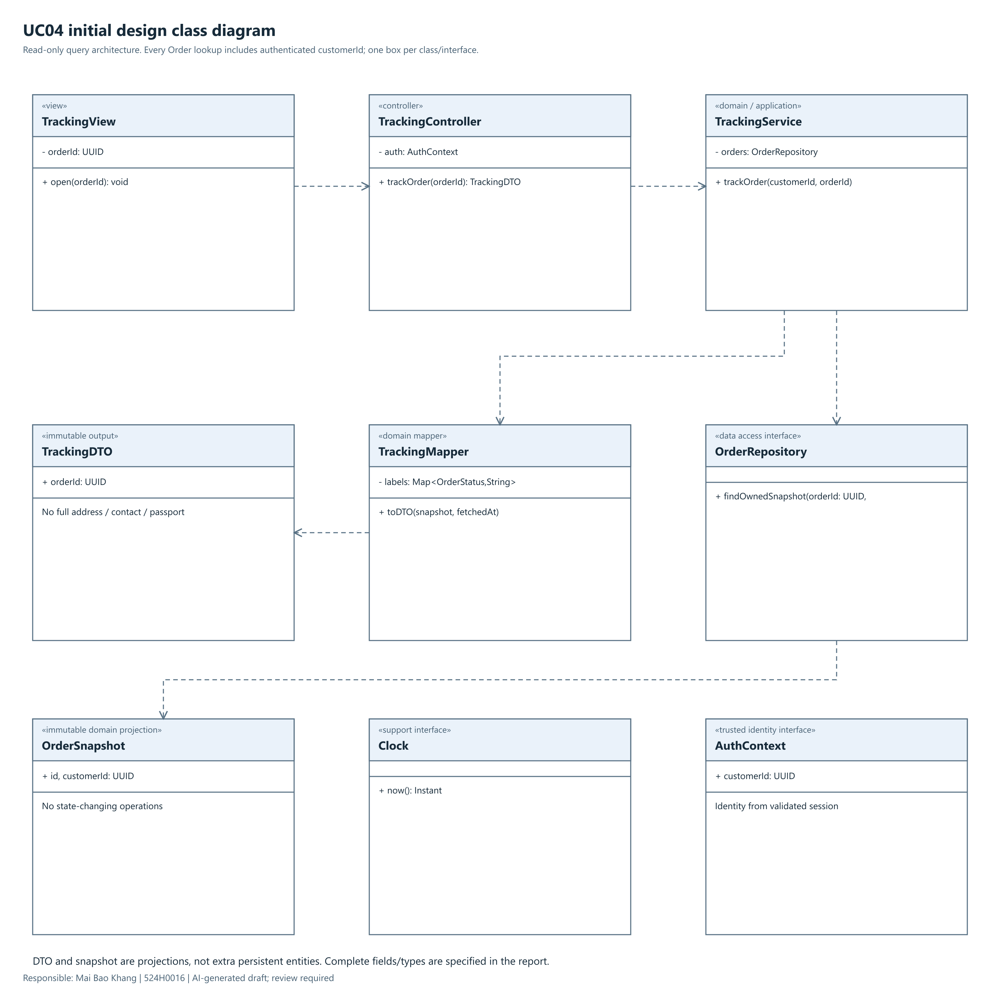
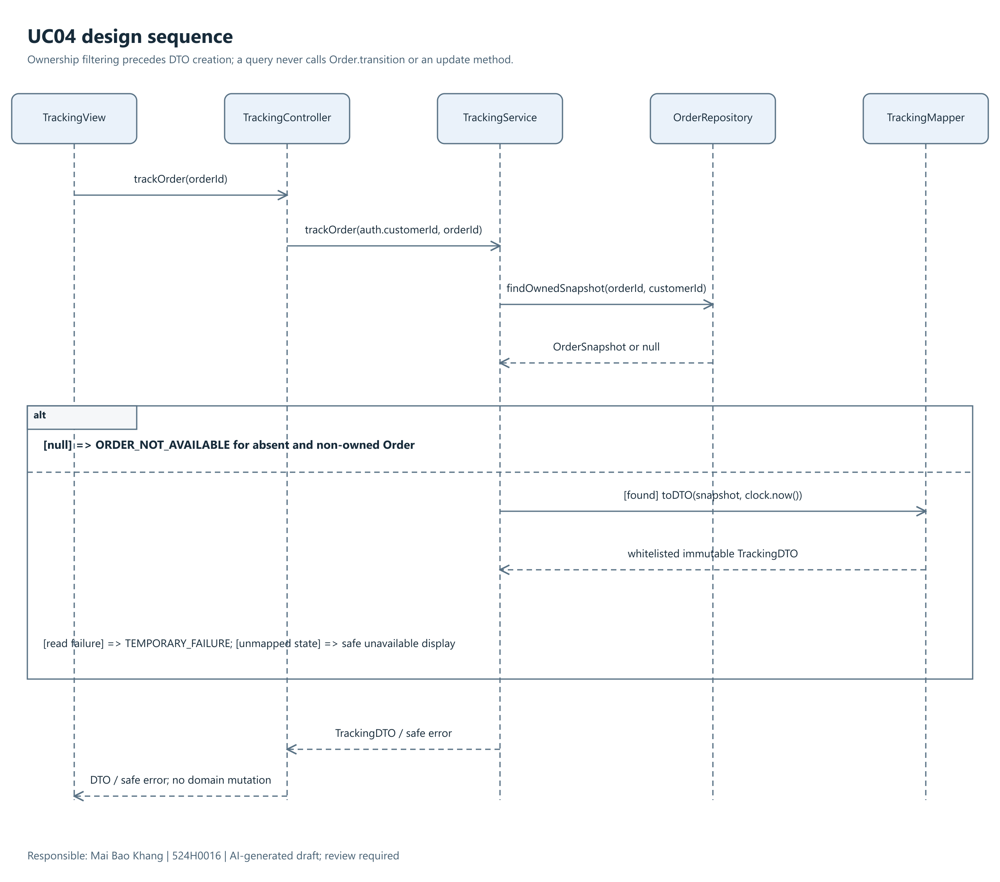
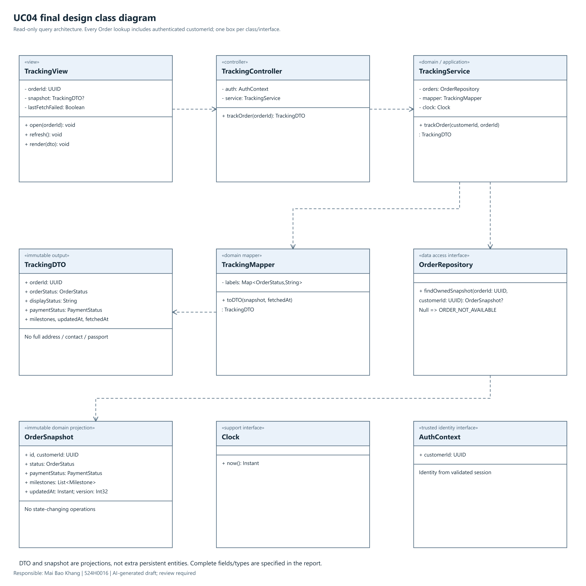

# III Customer Subsystem Design

**Responsible student:** Mai Bảo Khang — 524H0016. **AI-generated draft.** Các lớp dưới đây là specification; không phải source code đã thực thi. Tên operation cố ý khớp với SSD và design sequence.

## Architecture and types

Ba lớp logic: presentation; business/application (controller + domain/services); data access/integration. Sơ đồ gắn stereotype `view`, `controller`, `domain`, `data access` để hiển thị bốn vai trò đề yêu cầu. Controller lấy identity từ AuthContext và điều phối; domain chịu business rules; repository thực hiện truy vấn/transaction. View không gọi thẳng database; domain không phụ thuộc view.

Types: UUID = identifier; Instant = UTC timestamp; Money = Int64 VND theo A12; Decimal = distance; Int32 = quantity/version; `?` = optional; `List<T>` = collection. Visibility `+` public, `−` private. DTO và snapshots không mặc định là persistent domain classes. Order, OrderLine và capacity hub là dữ liệu lưu lâu dài cần Tài kiểm CRUD.

## UC04 Design classes

| Class / role | Attributes with visibility/type | Public operations |
|---|---|---|
| TrackingView / view | −orderId: UUID; −snapshot: TrackingDTO?; −lastFetchFailed: Boolean | +open(orderId: UUID): void; +refresh(): void; +render(dto: TrackingDTO): void; +showUnavailable(): void |
| TrackingController / controller | −auth: AuthContext; −service: TrackingService | +trackOrder(orderId: UUID): TrackingDTO |
| TrackingService / application-domain | −orders: OrderRepository; −mapper: TrackingMapper; −clock: Clock | +trackOrder(customerId: UUID, orderId: UUID): TrackingDTO |
| OrderSnapshot / immutable domain projection | +id: UUID; +customerId: UUID; +status: OrderStatus; +paymentStatus: PaymentStatus; +milestones: List<Milestone>; +reasonCode: String?; +updatedAt: Instant; +version: Int32 | Không có operation thay đổi; projection lấy từ Order |
| TrackingMapper / domain mapper | −labels: Map<OrderStatus,String> | +toDTO(snapshot: OrderSnapshot, fetchedAt: Instant): TrackingDTO |
| TrackingDTO / output contract | +orderId: UUID; +orderStatus: OrderStatus; +displayStatus: String; +paymentStatus: PaymentStatus; +milestones: List<Milestone>; +reasonCode: String?; +updatedAt: Instant; +fetchedAt: Instant | DTO không chứa passport/full address/contact/token |
| OrderRepository / data access interface | Không có dữ liệu public | +findOwnedSnapshot(orderId: UUID, customerId: UUID): OrderSnapshot? |
| Clock / support interface | Không có dữ liệu public | +now(): Instant |

`TrackingController.trackOrder` lấy customerId từ AuthContext. `TrackingService` chỉ gọi repository với cả hai ID; null trả chung ORDER_NOT_AVAILABLE. Mapper whitelist không tự suy diễn các timestamp tương lai và không lưu state. DTO attributes public nghĩa là đọc dữ liệu; implementation nên immutable. Repository dùng một snapshot đọc nhất quán; cụ thể isolation/JSON/event storage sẽ chốt khi làm DB.

### Initial Design Class Diagram

### CRC cards for UC04

| Class | Responsibilities | Collaborators |
|---|---|---|
| TrackingView | Mở/refresh; hiển thị snapshot và lỗi/staleness trung thực | TrackingController |
| TrackingController | Lấy identity và điều phối đúng operation SSD | AuthContext, TrackingService |
| TrackingService | Tìm đơn chính chủ; lỗi chung; lấy fetchedAt | OrderRepository, TrackingMapper, Clock |
| TrackingMapper | Ánh xạ state và whitelist DTO; không tiết lộ PII | OrderSnapshot, TrackingDTO |
| OrderRepository | Đọc snapshot theo orderId AND customerId; không ghi | Persistent Order aggregate |

### Design Sequence Diagram

### Final Design Class Diagram

Bản final làm rõ identity server-side, query theo ownership, immutable snapshot và fetchedAt. UC04 không có phương thức update/transition Order trong đường gọi; audit/security logging nếu triển khai phải không làm đổi domain state.

