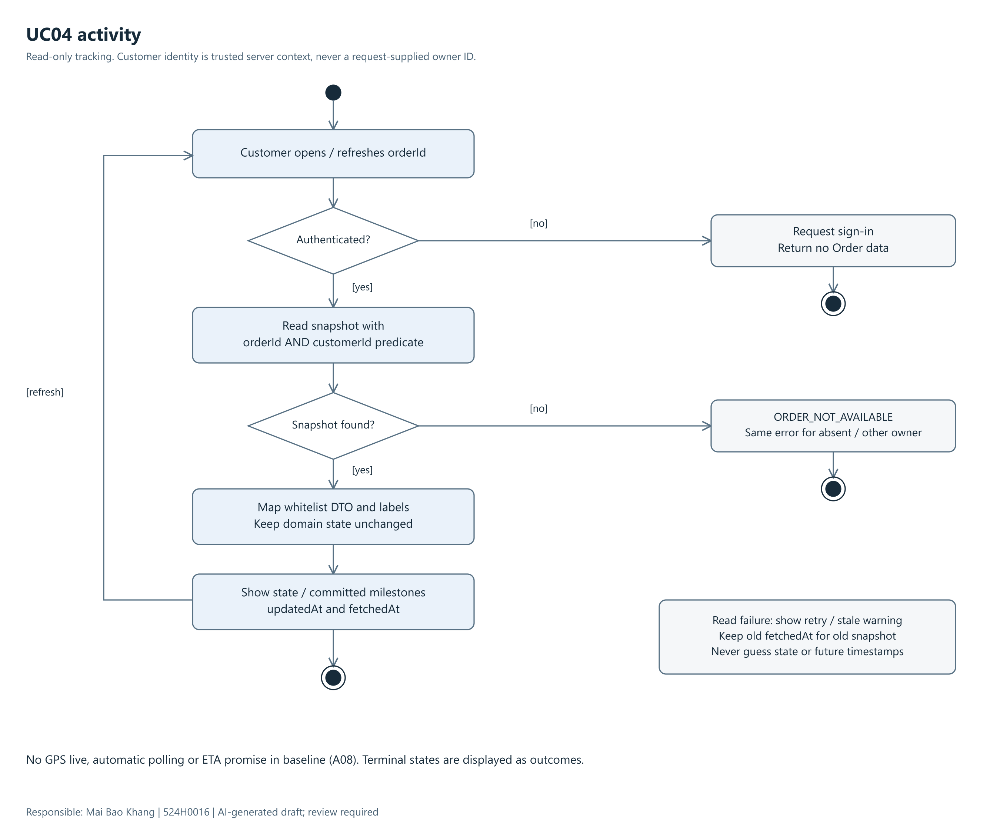
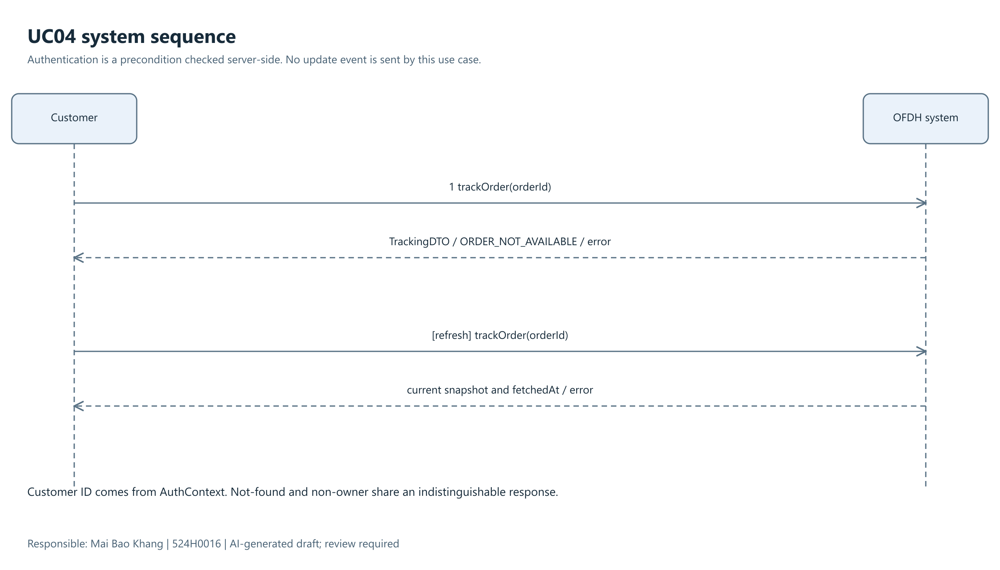

# II UC04 Track an Order

**Owner:** Mai Bảo Khang — 524H0016. **AI-generated draft.** Scope: Customer đọc tiến độ đơn, không thay đổi trạng thái hoặc xử lý hủy/hoàn tiền.

## Fully developed use case description

| Field | Specification |
|---|---|
| ID / name | UC04 — Track an Order |
| Level / primary actor | User goal / Customer (local or tourist) |
| Goal | Biết trạng thái và tiến độ mới nhất đọc được của một đơn do mình sở hữu |
| Trigger | Customer chọn Track sau khi đặt đơn, chọn đơn của mình, hoặc refresh trang tracking |
| Preconditions | P04.1 authenticated theo A01; P04.2 customer có orderId muốn tra cứu; sự tồn tại/ownership phải được kiểm tra, không giả định từ URL |
| Success guarantee | POST04.1 chỉ trả đơn chính chủ; POST04.2 status, milestones và updatedAt từ cùng snapshot đọc; POST04.3 không sửa Order/Payment/capacity; POST04.4 response chứa fetchedAt để khách biết lần tải |
| Minimal guarantee | Không trả PII/nội dung đơn khác khi lỗi; lỗi đọc không đổi trạng thái; UI không ghi dữ liệu cũ là dữ liệu mới |
| Related requirements | FR09–FR10; NFR01–03/06/08; A01/A05/A08/A12 |

### Main success scenario

1. Customer mở TrackingView với orderId.
2. TrackingView gọi `trackOrder(orderId)`; hệ thống lấy customerId từ AuthContext.
3. Hệ thống đọc Order bằng điều kiện đồng thời orderId và customerId, gồm trạng thái hiện tại và milestones trong cùng snapshot.
4. Hệ thống chuyển các trạng thái nội bộ sang nhãn Customer và tạo TrackingDTO theo whitelist dữ liệu.
5. Hệ thống trả mã đơn, state label/code, paymentStatus, milestones đã xảy ra, updatedAt và fetchedAt; có lý do thất bại/hủy ở dạng an toàn nếu được phép.
6. TrackingView hiển thị tiến độ và thời điểm cập nhật. Các bước tương lai chưa xảy ra chỉ được trình bày như dự kiến, không tự đặt timestamp.
7. Customer có thể refresh; lặp lại bước 2–6 với snapshot mới. Kết thúc khi Customer rời màn hình.

### Alternatives and exceptions

| ID / location | Condition | System response |
|---|---|---|
| A04.1 / step 5–6 | Order đang AWAITING_PAYMENT | Hiển thị chờ thanh toán; không ghi bếp đã nhận; không tự đổi paymentStatus |
| A04.2 / step 5–6 | Order DELIVERED, CANCELLED hoặc DELIVERY_FAILED | Hiển thị kết quả cuối, thời điểm và lý do an toàn khi có; không tiếp tục giả progress |
| A04.3 / step 7 | Refresh nhưng state không đổi | Trả snapshot hiện tại; fetchedAt mới, updatedAt của domain không đổi |
| E04.1 / step 2 | Session hết hạn | Yêu cầu đăng nhập; không trả nội dung đơn; lỗi không làm đổi state |
| E04.2 / step 3 | Không tồn tại hoặc không thuộc customer | Cùng thông báo ORDER_NOT_AVAILABLE, không tiết lộ đơn đó có thuộc người khác hay không |
| E04.3 / step 3 | Database/network lỗi | Trả TEMPORARY_FAILURE; nếu UI còn snapshot cũ, đánh dấu không tải được và giữ fetchedAt cũ, cho retry |
| E04.4 / step 4 | State không được mapping/version không tương thích | Hiển thị trạng thái chưa khả dụng, không đoán kết quả; log mã kỹ thuật không chứa PII; cần sửa integration contract |

### Tracking data contract

`TrackingDTO = {orderId: UUID, orderStatus: OrderStatus, displayStatus: String, paymentStatus: PaymentStatus, milestones: List<Milestone>, reasonCode: String?, updatedAt: Instant, fetchedAt: Instant}`.

`Milestone = {status: OrderStatus, occurredAt: Instant}`. Chỉ có timestamp của transition đã commit. Không gửi passport, full address, số điện thoại, token hoặc dữ liệu khách khác trong DTO tracking. Nếu bổ sung dữ liệu giao nhận sau Q&A phải mở rộng whitelist có chủ đích.

OrderId ngẫu nhiên không thay thế kiểm tra quyền. Repository phải dùng `findOwnedSnapshot(orderId, customerId)`, không lấy Order bất kỳ rồi gửi ra client để kiểm tra.

## Activity Diagram

## System Sequence Diagram

## Link to lifecycle and testing

UC04 quan sát Order State Machine, không kích hoạt transition. State đến từ UC03/07/10 và các supporting flows đã nêu trong A13. POST04.1 tạo negative tests guest/khách khác/đơn không tồn tại; POST04.2 tạo consistency tests; POST04.3 yêu cầu so sánh state/version trước và sau truy vấn. Chưa có kết quả chạy test trong Sprint 1.
