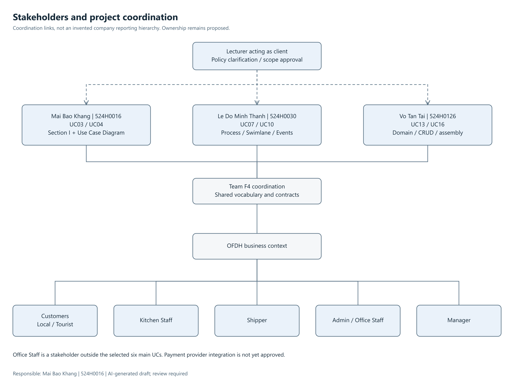
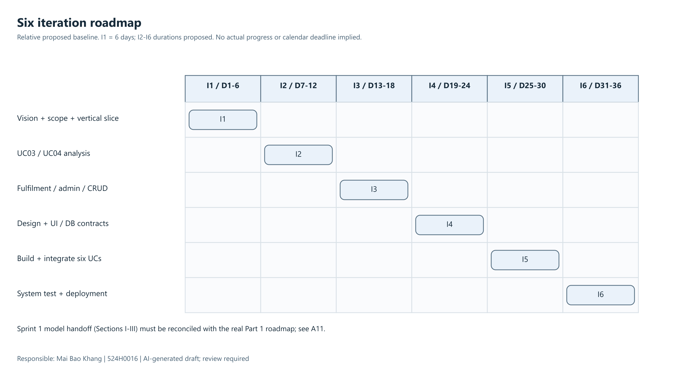

# I Business Requirements

**Responsible student:** Mai Bảo Khang — 524H0016. **AI-generated content:** KHANG phải kiểm chứng, sửa và giải thích trước khi nộp. Numbering 1.1–1.7 dưới đây là cấu trúc làm việc cần đối chiếu RAD Report Template.

## 1.1 System Vision and Approval Record

### Problem and opportunity

SaigonBite vận hành nhiều cloud kitchen tại TP.HCM, mỗi hub phục vụ nhiều virtual brand và chỉ nấu để giao. Đơn hiện đi qua điện thoại, Zalo và ứng dụng bên thứ ba; nhân viên ghi giấy, gọi shipper thủ công và đối soát COD cuối ngày. Hệ quả là một hub quá tải trong khi hub khác nhàn, khách đặt trúng món đã hết, trạng thái đơn thiếu minh bạch và dữ liệu quản trị không đáng tin cậy. Khách du lịch còn gặp rào cản đăng ký, ngôn ngữ và thanh toán.

OFDH tập trung thông tin đặt món, năng lực hub và trạng thái thực hiện đơn. Customer biết hub/món khả dụng và tổng giá trước khi xác nhận; bếp kiểm soát nhận đơn; shipper cập nhật giao hàng; quản trị viên quản lý hub; manager xem báo cáo. Dữ liệu nhất quán giúp giảm gọi điện tra cứu, hạn chế nhận đơn vượt năng lực và hỗ trợ mở rộng hub.

### Capabilities and scope

| Capability | Giá trị nghiệp vụ | Main UC trong portfolio |
|---|---|---|
| Tạo đơn với phí, một voucher và phương thức thanh toán | Minh bạch giá; giảm nhập liệu thủ công | UC03 — Khang |
| Xem tiến độ đơn của chính khách | Giảm nhu cầu gọi hỏi; tránh lộ dữ liệu | UC04 — Khang |
| Bếp xác nhận/từ chối đơn | Tránh nhận đơn không đáp ứng được | UC07 — Thành |
| Nhận giao, giao xong, xác nhận COD hoặc báo thất bại | Theo dõi trách nhiệm và kết quả giao | UC10 — Thành |
| CRUD hub và cấu hình năng lực | Quản trị dữ liệu hub có kiểm soát | UC13 — Tài |
| Báo cáo doanh thu, tải hub, hiệu quả giao | Ra quyết định vận hành | UC16 — Tài |

Đăng ký khách, CRUD địa chỉ/menu/voucher, chuẩn bị món UC08, khiếu nại/hoàn tiền và thanh toán UC06 có trong bối cảnh hệ thống nhưng không phải main UC đã chọn. Tích hợp tối thiểu hoặc dữ liệu tham chiếu của chúng phải được công bố rõ. Loyalty, subscription, group order và scheduled order là ý tưởng tương lai, không đưa vào scope hiện tại.

### Expected business benefits

Kỳ vọng giảm sai đơn và giao tiếp thủ công; công khai phí và trạng thái; cân bằng nhận đơn theo năng lực hub; tạo dữ liệu báo cáo nhất quán. Chưa có baseline vận hành để tuyên bố phần trăm cải thiện. Gợi ý đo sau triển khai: thời gian từ tạo đến xác nhận đơn, tỷ lệ bị từ chối do hết món/quá tải, số cuộc hỏi trạng thái/đơn và tỷ lệ sai đối soát COD. Mục tiêu số chỉ được chốt sau khi có baseline và client xác nhận.

### Approval record

| Record | Nguồn/bằng chứng | Nội dung | Thay đổi và trạng thái |
|---|---|---|---|
| APR-01 | Chưa có feedback Part 1 trong hồ sơ đầu vào | Chưa có nhận xét cụ thể để trích | Chưa ghi thay đổi do feedback; chờ bằng chứng |
| APR-02 | File phân công Sprint 1, mục 1 | Ownership là đề xuất | Chờ nhóm xác nhận; không coi là lecturer approval |

Khi nhận feedback thực, thêm một dòng gồm ngày, người phản hồi, nội dung, phần đã sửa, bằng chứng và trạng thái. Không dùng vision hoặc bản phân công làm chứng cứ giảng viên đã duyệt.

## 1.2 Stakeholders and Project Organization

| ID | Stakeholder | Nhu cầu/quyền lợi | Vai trò trong scope |
|---|---|---|---|
| ST01 | Local Customer | Đặt món, biết phí, thanh toán phù hợp, giữ kín địa chỉ | Actor UC03/04; số VN là dữ kiện đăng ký từ case |
| ST02 | Foreign Tourist | Tiếp cận menu và phương thức online phù hợp; giao tới khách sạn | Customer UC03/04; passport/email là dữ kiện đăng ký từ case |
| ST03 | Kitchen Staff | Nhận/từ chối theo khả năng thực tế | Actor UC07; cung cấp state cho UC04 |
| ST04 | Shipper | Biết đơn nhận giao; cập nhật kết quả và COD | Actor UC10; cung cấp state cho UC04 |
| ST05 | Admin | CRUD hub, cấu hình capacity | Actor UC13 |
| ST06 | Manager | Báo cáo sales/workload/delivery performance | Actor UC16; stakeholder nghiệp vụ |
| ST07 | Office Staff | Khiếu nại/hoàn tiền | Bối cảnh, ngoài sáu main UC |
| ST08 | Lecturer as client | Xác nhận chính sách và scope, phản hồi proposal | Người trả lời Q&A; không giả lập approval |
| ST09 | Team F4 | Mô hình nhất quán, tích hợp và chứng cứ cá nhân | Khang/Thành/Tài theo ownership đề xuất |

Organization chart dùng quan hệ phối hợp và sở hữu artifact, không suy diễn quan hệ quản lý nội bộ công ty. Brand và hub là khái niệm nghiệp vụ, không tự biến thành actor. Nhà cung cấp thanh toán là interface tương lai, chưa tuyên bố tích hợp thực.

## 1.3 Iteration Plan Backlog Risks and Schedule

### Ownership

| Student | ID | Main UC | Shared responsibility |
|---|---|---|---|
| Mai Bảo Khang | 524H0016 | UC03 Place an Order; UC04 Track an Order | Section I; overall Use Case Diagram |
| Lê Đỗ Minh Thành | 524H0030 | UC07 Confirm/Reject Incoming Order; UC10 Deliver Order | Process flow, Swimlane, Events Table |
| Võ Tấn Tài | 524H0126 | UC13 Manage Hubs and Kitchen Capacity; UC16 Produce Management Reports | Domain Model, CRUD verification, report/slides/workbook assembly |

### Six iteration roadmap

Kế hoạch dưới đây là baseline đề xuất để đồng bộ proposal, không phải tiến độ đã thực hiện. I1 bắt buộc sáu ngày theo đề; I2–I6 tạm chia sáu ngày/iteration để ước lượng, cần thay bằng lịch đã xác nhận. Sprint 1 trong file phân công hiện tại là mốc bàn giao mô hình I–III, không tự đồng nhất với Iteration 1 của Part 1.

| Iteration | Relative days | Goal and stories | Deliverables and exit criteria |
|---|---|---|---|
| I1 | D1–D6 | Chốt vision, portfolio; lát cắt UC03/07, dữ liệu hub tối thiểu | Proposal, roadmap, proof of concept nhỏ và test lát cắt theo chapter 1; không ghi đã xong khi chưa có bằng chứng |
| I2 | D7–D12 | Hoàn thiện phân tích UC03/04, US01–04/06–07 | Description, Activity, SSD, Order states; policy questions được ghi log |
| I3 | D13–D18 | Phân tích fulfilment và admin/report, US05/08–10 | Events/domain/CRUD được review; xử lý gate scope |
| I4 | D19–D24 | Thiết kế lớp, interaction, UI/DB cho sáu UC | Design review nhất quán; interface và schema được chốt |
| I5 | D25–D30 | Build và tích hợp sáu UC trong phạm vi được duyệt | Source, SQL, giao diện; test tích hợp có kết quả thật |
| I6 | D31–D36 | System test, deployment, report và demo | Test evidence, hướng dẫn chạy, tagged release, PDF chuẩn template |

### Prioritized user story backlog

Mức Must/Should là ưu tiên đề xuất. Acceptance criteria dưới đây là điều kiện kiểm tra, không phải kết quả test đã chạy.

| Story | User story | Priority / UC / owner | Acceptance criteria |
|---|---|---|---|
| US01 | As Customer, tôi muốn chọn hub và món khả dụng để đặt món có thể phục vụ | Must / UC03 / Khang | Hub nhận đơn; món thuộc hub; số lượng hợp lệ; lỗi không tạo đơn |
| US02 | As Customer, tôi muốn xem breakdown trước khi xác nhận | Must / UC03 / Khang | Có subtotal, delivery fee, surcharge, discount, total, currency; tổng không âm |
| US03 | As Customer, tôi muốn dùng tối đa một voucher | Must / UC03 / Khang | Kiểm tra điều kiện cấu hình; mã sai không được âm thầm áp dụng |
| US04 | As Customer, tôi muốn chọn phương thức được hỗ trợ | Must / UC03 / Khang | COD có cho cả hai loại khách; online theo policy; trạng thái không nói paid khi chưa có xác nhận |
| US05 | As Kitchen Staff, tôi muốn nhận/từ chối đơn theo khả năng hub | Must / UC07 / Thành | Chỉ xử lý trạng thái hợp lệ; có lý do khi từ chối; không nhận vượt giới hạn policy |
| US06 | As Customer, tôi muốn xem trạng thái đơn của mình | Must / UC04 / Khang | Chỉ chủ đơn xem; hiển thị state và mốc đã có; đọc không đổi state |
| US07 | As Customer, tôi muốn biết thời điểm dữ liệu được cập nhật | Should / UC04 / Khang | Có updatedAt và refresh; lỗi không hiển thị dữ liệu cũ như dữ liệu mới |
| US08 | As Shipper, tôi muốn ghi kết quả giao và COD | Must / UC10 / Thành | Nhận giao đúng đơn; delivered/failed có dấu thời gian; COD phân biệt thu được/chưa thu |
| US09 | As Admin, tôi muốn CRUD hub và capacity | Must / UC13 / Tài | Có C/R/U/D hoặc archive được chấp thuận; kiểm tra dữ liệu và đơn đang hoạt động |
| US10 | As Manager, tôi muốn báo cáo theo thời gian và hub | Must / UC16 / Tài | Bộ lọc và định nghĩa sales/workload/performance rõ; số liệu đối chiếu được |
| US11 | As Team, chúng tôi muốn giải quyết lifecycle persistent entities | Must / chung / Tài điều phối | Ma trận không có D/archive giả; mọi gap có quyết định của giảng viên |

### Risk list

| Risk | Probability / impact | Response and trigger | Owner |
|---|---|---|---|
| R01 Chính sách phí/voucher/capacity chưa rõ | High / High | A02/A03/A06; hỏi client; không hard-code số chưa duyệt | Khang |
| R02 State lệch giữa Customer–Kitchen–Shipper | High / High | Một state contract; review sau mỗi sửa; trigger: xuất hiện state ngoài bảng | Thành + Khang |
| R03 Thiếu CRUD persistent entity | High / High | Gate G05; inventory với Tài trước chốt domain/scope | Tài |
| R04 Online payment vượt phạm vi sáu UC | Medium / High | G06; tách trạng thái tiền; không tuyên bố payment hoàn chỉnh | Nhóm |
| R05 Đặt trùng hoặc món/capacity thay đổi lúc xác nhận | Medium / High | Quote revision, atomic admission, request idempotency | Khang |
| R06 Lộ địa chỉ và đơn của khách khác | Medium / High | Kiểm tra ownership tại service/repository; whitelist DTO; negative tests khi build | Khang |
| R07 Ghép template/ảnh muộn, thiếu source/ID | High / Medium | Manifest, source drawio+PNG; kiểm tra trước ghép | Tài + mỗi owner |
| R08 Hạn nộp chưa xác nhận, thời gian tích hợp ngắn | High / High | Kiểm tra eLearning; ưu tiên Must; không mở thêm tính năng | Nhóm |
| R09 Dùng nội dung AI nhưng không hiểu/khai báo | Medium / High | Gắn nhãn; lưu prompt/output; walkthrough cá nhân | Mỗi thành viên |

## 1.4 Business Narrative

### Current business

Đơn tới từ nhiều kênh, được ghi giấy và ghim bảng tại bếp. Nhân viên không nhìn thấy tải hub khác và phải liên hệ khách khi món hết. Shipper được gọi riêng hoặc qua nhóm chat. COD được bàn giao cuối ngày, dễ sai sót. Voucher áp dụng tay; khiếu nại/refund do manager xử lý riêng. Thiếu báo cáo và menu phù hợp cho khách du lịch.

### Proposed business

Customer chọn hub và các món đang phục vụ ở hub đó; hệ thống kiểm tra địa chỉ theo khoảng cách giao tối đa. Khách có thể dùng một voucher và chọn phương thức thanh toán theo loại khách. Hệ thống trả breakdown và quote revision để khách xác nhận. Tại thời điểm xác nhận, hệ thống kiểm tra lại quyền, giá, món và khả năng nhận đơn; nếu có thay đổi thì yêu cầu khách xem và xác nhận quote mới, không tự tăng giá.

Theo A04, COD tạo Order ở PENDING_CONFIRMATION với payment UNPAID; online tạo AWAITING_PAYMENT và chưa cho bếp nhận. Sau kết quả thanh toán được xác thực, component thanh toán hỗ trợ chuyển đơn sang PENDING_CONFIRMATION. Phần thực thi online cần được nhóm phân công trước khi tuyên bố đã build đầy đủ.

Kitchen Staff nhận hoặc từ chối đơn qua UC07. Đơn đã nhận chuyển qua chuẩn bị và sẵn sàng; đây là dependency UC08 chưa được chọn, cần chốt cách cung cấp transition hợp lệ cho bản tích hợp. Shipper nhận đơn READY_FOR_PICKUP qua UC10, giao và ghi kết quả hoặc thất bại. UC04 đọc state và các mốc tiến độ của đúng khách, không tự chuyển state. Khách có thể refresh; không giả định có GPS trực tiếp.

Admin quản lý hub/capacity; Manager xem báo cáo dựa trên định nghĩa thống nhất. Khiếu nại/refund vẫn là bối cảnh ngoài sáu UC. Không đồng nhất DELIVERED với đã thu đủ tiền trong mọi phương thức thanh toán.

## 1.5 Assumption Log and Client Questions

Tất cả A dưới đây là **PROPOSED, chưa có client/lecturer xác nhận**. Đó là quyết định làm việc để mô hình cụ thể, không thay thế yêu cầu cố định trong case.

| ID | Assumption / decision | Reason and impact | Confirmation owner |
|---|---|---|---|
| A01 | UC03/04 yêu cầu customer đăng nhập; UC04 chỉ đọc đơn chính chủ | Chống truy cập bằng mã đơn đoán được; registration ngoài sáu UC | Client + nhóm |
| A02 | DistancePolicy cấu hình bán kính và cách đo distance; không chốt con số | Case chỉ xác nhận có giới hạn và phí phụ thuộc distance | Client |
| A03 | Busy threshold, capacity unit, quiet incentive là cấu hình; đơn được nhận giữ một capacity slot | Chống oversubscription; quy tắc giữ/nhả slot ảnh hưởng UC07/10/13 | Client + Thành/Tài |
| A04 | COD → PENDING_CONFIRMATION/UNPAID; online → AWAITING_PAYMENT/UNPAID; payment verified → PENDING_CONFIRMATION/PAID | Tách đặt đơn với thực thi thanh toán; chưa có owner payment support | Client + nhóm |
| A05 | Dùng state vocabulary trong State Contract; chỉ state hợp lệ được chuyển | Case chưa đưa tên/state graph cụ thể | Client + Thành |
| A06 | Voucher điều kiện/thời hạn/hạn mức là policy cấu hình; một mã/đơn | Case chưa cho công thức, ưu tiên quiet incentive hay voucher cần chốt | Client |
| A07 | Quote có revision/expiry cấu hình; confirm revalidate; clientRequestId duy nhất theo customer | Giá/thực phẩm/capacity thay đổi đồng thời, retry không tạo trùng | Nhóm + client |
| A08 | UC04 refresh theo yêu cầu; không GPS live/ETA cam kết trong baseline | Case yêu cầu theo tiến độ nhưng không bắt buộc GPS | Client |
| A09 | NFR mục tiêu ở 1.7 là tiêu chí đề xuất để đo khi build | Chưa có SLA/baseline được duyệt | Client + nhóm |
| A10 | Quyền truy cập master data và lifecycle/archive persistent entity chưa được cấp trong portfolio | CRUD ground rule đang có gap, cần quyết định scope hợp lệ | Giảng viên + Tài |
| A11 | I2–I6 sáu ngày là ước lượng tương đối; mốc Sprint 1 từ phân công cần xác minh | Không có lịch proposal/Canvas thực để lập actual Gantt | Nhóm |
| A12 | VND và tiền dùng integer đồng; timezone lưu UTC/hiển thị Asia/Ho_Chi_Minh | Tránh lỗi float và timeline; case chưa xác nhận currency/display policy | Client + nhóm |
| A13 | Transition chuẩn bị/ready, hủy/timeout và payment update là dependency hỗ trợ, chưa có owner hoàn chỉnh | Sáu UC không bao trọn vòng đời; không tự thêm main UC | Nhóm + giảng viên |
| A14 | Số lượng/availability được kiểm tra và commit trong cùng transaction; không quản lý nguyên liệu chi tiết | Case không cho inventory model; boolean availability chưa đủ quantity stock | Nhóm + client |

### Five prioritized client questions

1. **Phạm vi và CRUD:** Với đúng sáu main UC, lớp persistent nào bắt buộc quản lý lifecycle? Cho phép archive đơn ở đâu, CRUD customer/menu/voucher do UC nào đảm nhiệm, và dependency chuẩn bị/ready được phân công thế nào?
2. **Hub và giao hàng:** Bán kính tối đa, cách đo khoảng cách, công thức phí/phụ phí, capacity unit, ngưỡng bận và thời điểm giữ/nhả slot là gì?
3. **Ưu đãi và quote:** Điều kiện voucher, cách kết hợp với ưu đãi hub vắng, làm tròn tiền, hiệu lực quote và cách xử lý món/giá đổi trước xác nhận là gì?
4. **Thanh toán:** Online methods cho local/tourist, trạng thái/timeout/refund và mức triển khai cần có khi nhóm không chọn UC06? Ai chịu trách nhiệm supporting payment flow?
5. **Customer và tracking:** Có bắt buộc đăng nhập, chỉ xem đơn chính chủ, hiển thị những trường nào, cần GPS/ETA/ngôn ngữ nào, và mục tiêu performance/privacy/retention nào phải đạt?

## 1.6 Business Process and Swimlane Handoff

Thành phụ trách hai sơ đồ tổng thể và Events Table. Dùng nội dung narrative 1.4 và State Contract để ghép; sơ đồ của Khang không thay thế artifact của Thành.

| Lane/event | Contract cung cấp cho Thành | Expected agreement |
|---|---|---|
| Customer → OFDH | submitDraft, requestQuote, confirmOrder, trackOrder | Trước confirm phải có breakdown; tracking là read-only |
| OFDH → Kitchen | order becomes PENDING_CONFIRMATION | Không đưa AWAITING_PAYMENT vào danh sách nhận |
| Kitchen → OFDH | acceptOrder/rejectOrder + version | Chỉ transition hợp lệ, từ chối có lý do |
| Preparation dependency | ACCEPTED → PREPARING → READY_FOR_PICKUP | Ghi owner dependency A13; không giả lập đã implement UC08 |
| Shipper → OFDH | pickupOrder/completeDelivery/reportFailure | UC10 chỉ pickup READY_FOR_PICKUP; COD update riêng |
| Payment dependency | verifiedPayment hoặc unpaid timeout | Chỉ server-verified event; không tin browser redirect |

## 1.7 Functional and Nonfunctional Requirements

### Functional requirements in portfolio

| ID | Requirement | Source / verification | UC |
|---|---|---|---|
| FR01 | Cho phép customer đã xác thực chọn một hub và các món/số lượng hợp lệ tại hub đó | Case p1; A01/A14; review draft validation | 03 |
| FR02 | Chặn đơn ngoài khoảng cách giao tối đa, tính phí theo DistancePolicy được xác nhận | Case p2; A02; boundary tests | 03 |
| FR03 | Hiển thị subtotal, deliveryFee, surcharge, discount, total và currency trước confirm | Case p1; formula tests và UI review | 03 |
| FR04 | Cho dùng tối đa một voucher; kiểm tra điều kiện cấu hình và trả lý do không hợp lệ | Case p2; A06; invalid/multiple voucher tests | 03 |
| FR05 | Cho cả local/tourist chọn COD; online theo loại khách và policy; không báo paid khi chưa xác thực | Case p1–2; A04; payment-state tests | 03 |
| FR06 | Hub quá bận dừng nhận mới; thể hiện gợi ý hub vắng và incentive theo cấu hình | Case p1–2; A03; capacity boundary review | 03/13 |
| FR07 | Confirm revalidate quote/món/capacity và tạo Order/OrderLine atomically; retry cùng request không tạo thêm đơn | A07/A14; concurrency/rollback/idempotency tests | 03 |
| FR08 | Trả orderId, orderStatus, paymentStatus và confirmed total sau confirm | Case + A04; postcondition tests | 03 |
| FR09 | Customer chỉ truy cập đơn được phép; không lộ nội dung đơn khác trong lỗi | Case privacy + A01; authorization tests | 04 |
| FR10 | Hiển thị state hiện tại, mốc tiến độ đã có và thời điểm cập nhật; refresh không làm đổi state | Case p1 + A08; state mapping/read-only tests | 04 |
| FR11 | Kitchen Staff chỉ xác nhận/từ chối đơn đủ điều kiện, lưu lý do từ chối | Case p1 + A05; transition tests | 07 |
| FR12 | Shipper pickup, deliver, ghi COD hoặc delivery failure theo state contract | Case p1; A05; fulfilment tests | 10 |
| FR13 | Admin có Create/Read/Update/Delete hoặc archive hợp lệ cho hub/capacity | Project requirement p1–2; CRUD evidence | 13 |
| FR14 | Manager lọc và xem sales/workload/delivery reports, định nghĩa số đo được công bố | Case p2; reconcile report data | 16 |

Ngoài portfolio: register/profile/addresses; browse đầy đủ; menu availability management; cancel/edit; payment execution; rate; complaints/refunds; brands/menu/voucher/account administration. Đây là business capabilities đã nêu trong case, không tuyên bố chúng đã được sáu UC triển khai đầy đủ. Ground rule CRUD vẫn áp dụng khi nhóm mô hình các dữ liệu đó là persistent.

### Nonfunctional requirements

Tất cả ngưỡng định lượng bên dưới là **PROPOSED (A09)**; chỉ được ghi đạt khi có test thật trên cấu hình được mô tả.

| ID | Proposed requirement and acceptance measure | Verification later |
|---|---|---|
| NFR01 | Không truy cập trái quyền đơn; mọi UC03/04 yêu cầu authentication và ownership server-side | Negative auth tests cho guest/customer khác; không trả PII trong lỗi |
| NFR02 | API/web triển khai dùng TLS; log không chứa địa chỉ/số điện thoại/passport/token thô | Config inspection và log review |
| NFR03 | p95 quote ≤2s, tracking ≤2s với 50 concurrent customers trên test environment được công bố; không tính mạng/provider ngoài | Load report kèm data size, hardware, percentile |
| NFR04 | Không tạo đơn trùng khi gửi lại clientRequestId; không commit order thiếu lines/total; không vượt capacity trong bài test cạnh tranh | Retry, fault injection, concurrent admission tests |
| NFR05 | UI breakdown rõ, lỗi cạnh field có hành động sửa; 5/5 người thử hoàn thành COD order và track trên kịch bản chuẩn không cần hướng dẫn | Usability session log; baseline language phải chốt với client |
| NFR06 | Các lớp UI/application/domain/data access tách trách nhiệm; domain không phụ thuộc UI | Design/code dependency review |
| NFR07 | Hỗ trợ thêm hub bằng dữ liệu cấu hình, không đổi source của pricing/capacity vì thêm hub | Add-hub integration test |
| NFR08 | Timeline lưu timestamp UTC, hiển thị timezone đã công bố; tổng tiền dùng kiểu nguyên VND theo A12 | Timezone và money boundary tests |

### Business rules

BR01: hub chỉ phục vụ delivery và có capacity hữu hạn. BR02: khách local và tourist khác registration/online methods nhưng đều có COD. BR03: tối đa một voucher/đơn. BR04: có giới hạn distance và phí theo distance. BR05: có busy rule và quiet incentive. BR06: không nhận Order vào bếp trước điều kiện state/payment đã chốt. BR01–05 xuất phát từ case; công thức/số cụ thể và BR06 vẫn cần Q&A.
